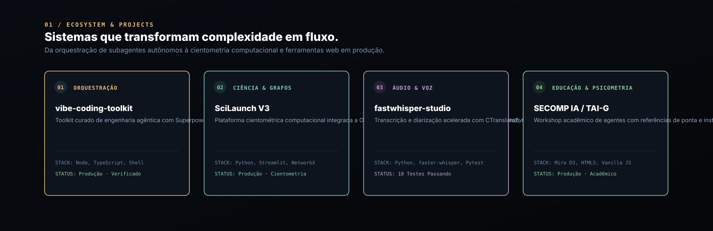
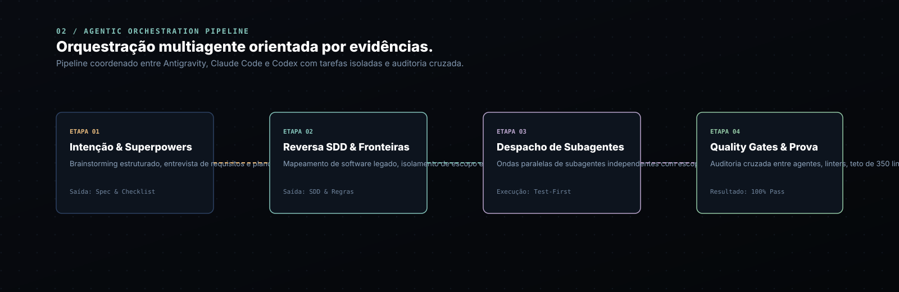
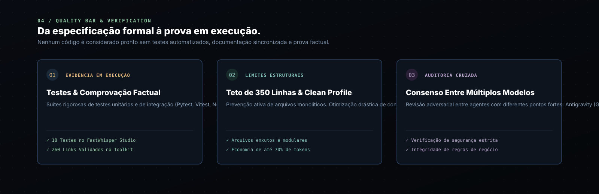

[Português (Brasil)](README.md) · **English** · [Español](README.es.md)

<picture>
  <source media="(prefers-reduced-motion: reduce)" srcset="docs/assets/readme/hero-still.svg">
  
</picture>

# Emmanuel Nunes

**Software Architect, AI Agentic Systems Specialist, and Computational Researcher.**

I build systems that transform complex workflows into agile, elegant, and reliable solutions. My work bridges the frontier of **Agentic Engineering** (coordinated orchestration across Antigravity, Claude Code, and Codex, Reversa SDD, Mira D3.js, and REA) with the rigor of **computational scientometrics** and production software delivery.

<p align="center"><a href="#choose-path"><strong>CHOOSE PATH →</strong></a> &nbsp; · &nbsp; <a href="#ecosystem"><strong>ECOSYSTEM</strong></a> &nbsp; · &nbsp; <a href="#agentic"><strong>AGENTIC ENGINEERING</strong></a> &nbsp; · &nbsp; <a href="#science"><strong>RESEARCH</strong></a> &nbsp; · &nbsp; <a href="#quality"><strong>QUALITY</strong></a> &nbsp; · &nbsp; <a href="#connect"><strong>CONNECT</strong></a></p>

---

<a id="choose-path"></a>
## 00 / Choose where to explore

| Your interest or goal | Recommended path | What you will find |
|---|---|---|
| **Engenharia Agêntica & Toolkit** | [EmmanuelNunes/vibe-coding-toolkit](https://github.com/EmmanuelNunes/vibe-coding-toolkit) | Metodologia completa, Superpowers, Reversa SDD, Mira D3.js, prompts e templates. |
| **Cientometria & Grafos Complexos** | [EmmanuelNunes/Ecossistema-SciLaunch-V3](https://github.com/EmmanuelNunes/Ecossistema-SciLaunch-V3) | Plataforma de inteligência acadêmica com OpenAlex, PageRank e Career-AI. |
| **Processamento de Áudio & Voz** | [EmmanuelNunes/fastwhisper-web-studio](https://github.com/EmmanuelNunes/fastwhisper-web-studio) | Transcrição e diarização acelerada com CTranslate2, Gradio e 18 testes automatizados. |
| **Educação & Workshops de IA** | [EmmanuelNunes/SECOMP---IA](https://github.com/EmmanuelNunes/SECOMP---IA) | Apresentações animadas Mira D3.js e referências acadêmicas (Sandeco e Gulo). |
| **Instrumentos Psicométricos** | [EmmanuelNunes/Teste-de-Alfabetiza-o-em-IA-Generativa](https://github.com/EmmanuelNunes/Teste-de-Alfabetiza-o-em-IA-Generativa) | Teste psicométrico TAI-G calibrado e publicado no GitHub Pages com integração Forms. |
| **Ecossistema Modular de Plugins** | [EmmanuelNunes/deepseek-harness-custom](https://github.com/EmmanuelNunes/deepseek-harness-custom) | Harness de agentes baseado em Cordis onde tudo é um plugin extensível. |
| **Aplicações Web Interativas** | [EmmanuelNunes/amigosecreto](https://github.com/EmmanuelNunes/amigosecreto) | Web app de sorteio seguro com inserção em lote, confetti e zero duplicatas. |

---

<a id="ecosystem"></a>
## 01 / Project and product ecosystem

<picture>
  <source media="(prefers-reduced-motion: reduce)" srcset="docs/assets/readme/ecosystem-still.svg">
  
</picture>

| Repositório | Domínio | Destaque Técnico | Link Direto |
|---|---|---|---|
| **vibe-coding-toolkit** | Orquestração & Agentes | Framework para orquestração multiagente, SDD e quality gates com 260 links validados. | [Ver Repositório →](https://github.com/EmmanuelNunes/vibe-coding-toolkit) |
| **Ecossistema-SciLaunch-V3** | Ciência de Dados & Redes | Algoritmos de centralidade de rede, OpenAlex API e Career-AI interativo. | [Ver Repositório →](https://github.com/EmmanuelNunes/Ecossistema-SciLaunch-V3) |
| **fastwhisper-web-studio** | Áudio & IA Local | Inferência ultrarrápida com CTranslate2, Gradio UI e 18 testes em Pytest. | [Ver Repositório →](https://github.com/EmmanuelNunes/fastwhisper-web-studio) |
| **SECOMP---IA** | Educação & D3.js | Slides dinâmicos com coreografia perpétua e fundamentação teórica de ponta. | [Ver Repositório →](https://github.com/EmmanuelNunes/SECOMP---IA) |
| **Teste-de-Alfabetiza-o-em-IA-Generativa** | Psicométrica & Avaliação | Escala de prontidão em IA Generativa com validação estatística e deploy web. | [Ver Repositório →](https://github.com/EmmanuelNunes/Teste-de-Alfabetiza-o-em-IA-Generativa) |
| **deepseek-harness-custom** | Plataforma de Agentes | Arquitetura de plugins reativos Cordis com harness configurável. | [Ver Repositório →](https://github.com/EmmanuelNunes/deepseek-harness-custom) |
| **amigosecreto** | Frontend & UX | Algoritmo estrito de desarranjo sem ciclos fixos e efeitos canvas-confetti. | [Ver Repositório →](https://github.com/EmmanuelNunes/amigosecreto) |

---

<a id="agentic"></a>
## 02 / Agentic engineering and orchestration

<picture>
  <source media="(prefers-reduced-motion: reduce)" srcset="docs/assets/readme/orchestration-still.svg">
  
</picture>

Minha abordagem de engenharia de software com agentes de IA supera o paradigma do "chat interativo" comum e adota uma **metodologia orquestrada de alto rendimento**:

1. **Reversa SDD (Spec-Driven Development):** Antes de qualquer linha de código, o sistema gera especificações formais com contratos de tipos, critérios de aceite e mapeamento de dependências.
2. **Isolamento de Contexto & Skills Dinâmicas:** Utilização do perfil de skills `clean` gerenciado por scripts para manter a janela de contexto limpa e concentrada, economizando até 70% dos tokens úteis.
3. **Despacho em Ondas Paralelas:** Tarefas independentes são distribuídas para subagentes focados que operam sem estado compartilhado, consolidando resultados no coordenador central.
4. **Inspeção Estrita com REA:** Capacidade de engenharia reversa nativa, web e binária para entender profundamente sistemas legados antes de modificá-los.

---

<a id="science"></a>
## 03 / Scientific research and academic production

A pesquisa científica é um dos pilares do meu trabalho. No **SciLaunch V3**, aplico modelos de grafos complexos para mapear colaborações científicas globais, calcular centralidade via PageRank e componentes fortemente conexos em tempo real a partir de dados abertos da API do OpenAlex.

No **TAI-G**, aplico fundamentos de psicometria e avaliação educacional para medir a prontidão e competência do público na transição para tecnologias generativas, fornecendo devolutivas imediatas e tabulação segura de evidências.

---

<a id="quality"></a>
## 04 / Quality, tests and verification

<picture>
  <source media="(prefers-reduced-motion: reduce)" srcset="docs/assets/readme/quality-still.svg">
  
</picture>

- **Contratos Formais:** Nenhuma suposição não testada entra na branch principal.
- **Teto Cognitivo de 350 Linhas:** Nenhum arquivo de código ultrapassa o limite cognitivo estrito, garantindo legibilidade e manutenção simplificada.
- **Auditoria Cruzada Antigravity + Claude Code + Codex:** O código crítico é revisado e desafiado por múltiplos modelos antes da integração.
- **Suítes Automatizadas:** Testes executados diretamente no terminal antes de qualquer commit ou publicação.

---

<a id="stack"></a>
## 05 / Technical stack and domains

| Área | Tecnologias Principais |
|---|---|
| **Linguagens & Runtimes** | Python 3.10+, TypeScript, JavaScript (Node.js ES Modules), Shell / PowerShell |
| **Inteligência Artificial & Áudio** | Antigravity, Claude Code, Codex, CTranslate2, faster-whisper, PyTorch |
| **Grafos & Ciência de Dados** | NetworkX, Pandas, NumPy, OpenAlex API, Algoritmos de Grafos (PageRank, Componentes) |
| **Frontend & Apresentações** | D3.js (coreografia e física), HTML5 Canvas, Streamlit, Gradio, Tailwind CSS |
| **Qualidade & Ferramentas** | Pytest, Node Test Runner, Git, GitHub Actions, DevTools, REA Engine |

---

<a id="profile-structure"></a>
## 06 / Profile repository structure and validation

```text
EmmanuelNunes/
├── assets/
│   └── profile_banner.svg
├── docs/
│   └── assets/
│       └── readme/
│           ├── hero.svg + hero-still.svg
│           ├── ecosystem.svg + ecosystem-still.svg
│           ├── orchestration.svg + orchestration-still.svg
│           └── quality.svg + quality-still.svg
├── scripts/
│   └── validate-docs.mjs
├── AGENTS.md
├── CLAUDE.md
├── README.md
├── README.en.md
└── README.es.md
```

---

<a id="connect"></a>
## 07 / Connect and follow

- **GitHub:** [github.com/EmmanuelNunes](https://github.com/EmmanuelNunes)
- **Toolkit Principal:** [github.com/EmmanuelNunes/vibe-coding-toolkit](https://github.com/EmmanuelNunes/vibe-coding-toolkit)
- **Contato & Parcerias:** Disponível via GitHub issues e discussões em repositórios abertos.

<p align="center">
  <br>
  <strong>BUILD WITH INTENT. SHIP WITH FLOW.</strong>
  <br><br>
  <a href="#emmanuel-nunes">Voltar ao topo ↑</a>
</p>
